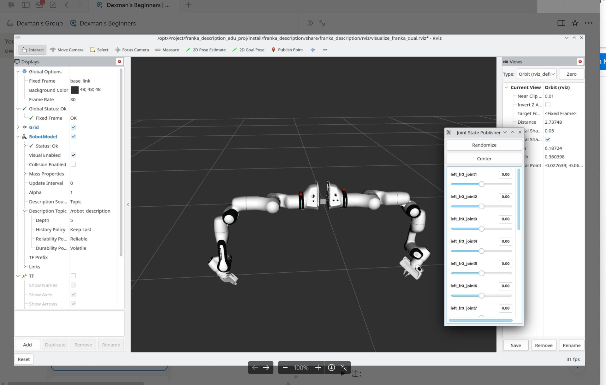

# 双臂 FR3 机器人模型（fr3_dual_arm）

课程作业仓库：`franka_description_edu_proj`（Kira）

在官方 `franka_description` 的单臂 FR3 模型基础上，用 **xacro 组合**的方式做出一个双臂 FR3 模型，并在 RViz2 中显示。

仓库链接：https://github.com/simon6-smarter/franka_description_edu_proj

---

## 运行效果



Fixed Frame 设为 `base_link`。左侧 Joint State Publisher 面板可以看到
`left_fr3_joint1` ~ `left_fr3_joint7` 和 `right_fr3_joint1` ~ `right_fr3_joint7`
两组彼此独立的关节，说明两条臂的命名空间确实分开了。

---

## 新增了哪些文件

| 文件 | 作用 |
| --- | --- |
| `robots/fr3_dual_arm/fr3_dual_arm.urdf.xacro` | 双臂模型主文件（核心交付物） |
| `launch/visualize_franka_dual_arm.launch.py` | 双臂可视化启动文件 |
| `rviz/visualize_franka_dual.rviz` | RViz2 配置，Fixed Frame 改为 `base_link` |
| `docs/urdf_view.jpg` | 上面的运行截图 |

**原有文件一个都没改**：`robots/fr3/fr3.urdf.xacro`、`robots/common/*`、
`launch/visualize_franka.launch.py`、`CMakeLists.txt` 全部保持原样，
单臂模型仍然可以照常启动。

---

## 实现思路

1. **先立一个公共根**：新建 `base_link`（一个小方块），两条臂都挂在它下面。
   单臂模型默认挂在 `base` 上，两条臂各自挂自己的 `base` 会互相打架，所以必须有一个共同父坐标系。

2. **复用官方宏，不复制 URDF**：只 `include` 一次
   `robots/common/franka_robot.xacro`，直接调用官方已经写好的 `franka_robot` 宏。
   没有把单臂展开成一份完整 URDF 再手工改名 —— 那样既容易漏改，也没法复用官方参数。

3. **用一个自定义宏把单臂参数化，实例化两次**：

   ```xml
   <xacro:macro name="arm" params="prefix socket y rpy">
     <xacro:franka_robot robot_type="fr3"
         arm_prefix="${prefix}"
         connected_to="${socket}" ... >
     </xacro:franka_robot>

     <joint name="${prefix}base_joint" type="fixed">
       <parent link="base_link"/>
       <child link="${socket}"/>
       <origin xyz="0 ${y} 0" rpy="${rpy}"/>
     </joint>
   </xacro:macro>
   ```

   - `arm_prefix="left_"` / `"right_"`：官方宏会自动给所有 link、joint 加前缀，
     于是生成 `left_fr3_joint1` 和 `right_fr3_joint1`，**两侧不会重名**。
   - `connected_to="left_base_link"` / `"right_base_link"`：官方宏会自己创建这个
     基座 link，以及它到 `${prefix}fr3_link0` 的 fixed joint，不用手写。
   - 再用 `${prefix}base_joint` 把这两个基座 link 接到公共 `base_link`。

4. **两臂镜像安装**：左臂 `rpy="-1.5708 1.5708 0"`，右臂 `rpy="1.5708 1.5708 0"`，
   配合 `y = ±arm_offset_y` 让两条臂相向摆放；间距由 `arm_offset_y` 一个参数控制，
   默认 `0.04`。

5. **可视化入口单独新增一个 launch**：`robot_type` 默认 `fr3_dual_arm`，
   用 `xacro.process_file()` 展开后交给 `robot_state_publisher`，
   同时启动 `joint_state_publisher_gui` 和带双臂配置的 `rviz2`。
   `load_gripper`、`ee_id` 都做成了启动参数。

---

## 怎么跑

```bash
# 在工作空间根目录
colcon build --packages-select franka_description
source install/setup.bash
ros2 launch franka_description visualize_franka_dual_arm.launch.py
```

可选参数：

```bash
ros2 launch franka_description visualize_franka_dual_arm.launch.py load_gripper:=false
ros2 launch franka_description visualize_franka_dual_arm.launch.py ee_id:=cobot_pump
```

打开 RViz 后确认 Global Options → Fixed Frame 是 `base_link`，
并勾选 RobotModel，即可看到两条机械臂。

---

## 验证记录

把 `$(find franka_description)` 映射到本仓库路径后，用 Python `xacro` 包直接展开
`fr3_dual_arm.urdf.xacro`（不依赖完整 ROS 环境）：

| 检查项 | 结果 |
| --- | --- |
| xacro 展开 | 成功 |
| 生成的 link / joint 数 | 53 / 52 |
| 重复 link 名 | 无 |
| `base_link` / `left_base_link` / `right_base_link` | 全部存在 |
| `left_fr3_joint1`~`left_fr3_joint8` | 8 个，存在 |
| `right_fr3_joint1`~`right_fr3_joint8` | 8 个，存在 |
| joint 的 parent / child 指向不存在的 link | 无 |

作为对照，官方单臂 `robots/fr3/fr3.urdf.xacro` 在同一环境下也能正常展开，
说明上面的展开结果不是环境配置造成的假象。
